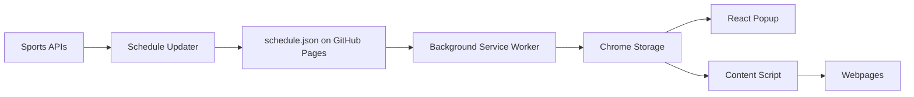

# StopSpoiling System Architecture

StopSpoiling has two main parts: a schedule updater and a Chrome extension. The updater collects game schedules, and the extension uses those schedules to decide what content might contain spoilers.

## How the Parts Work Together



### React Popup

The popup is what the user sees when opening the extension. It shows today's games and lets the user choose teams, add custom keywords, pause protection, and mark games as watched.

The popup does not scan webpages or download schedules directly.

### Content Script

The content script runs on websites such as Google, YouTube, Reddit, X, and ESPN. It checks page text for team names, scores, and result-related words. When it finds a possible spoiler, it blurs that content.

It also uses a `MutationObserver` to check new content that appears while the user scrolls.

### Background Service Worker

The background service worker downloads the latest schedule from GitHub Pages and saves it in Chrome storage. It also manages watched games and shares stored data with the popup and content script.

## Schedule Flow

1. GitHub Actions runs the Node.js schedule updater.
2. The updater requests games from a sports API.
3. The games are converted into one shared format.
4. The updater publishes `schedule.json` on GitHub Pages.
5. The background service worker downloads and stores the schedule.
6. The popup displays the games.
7. The content script uses the schedule to find possible spoilers.

## Shared Game Format

Every part of the project uses the same game structure:

```ts
interface Game {
  id: string;
  league: string;
  homeTeam: string;
  awayTeam: string;
  startTime: string;
}
```

The ID must stay the same when the schedule is refreshed. When possible, it will use the API provider and event ID:

```text
thesportsdb:2085437
```

This lets the popup, service worker, and content script recognize the same game.

## Watched Games

When the user marks a game as watched, its ID is added to an array in `chrome.storage.local`:

```json
{
  "watchedGameIds": ["thesportsdb:2085437"]
}
```

The content script ignores watched games but continues blocking spoilers for other games.

## Suggested Folders

```text
extension/src/
├── popup/        React popup
├── background/   Service worker
├── content/      Webpage scanning and blurring
├── matching/     Spoiler-matching rules
└── shared/       Game types, storage types and messages

updater/src/
├── providers/    Sports API connections
├── normalize.ts  Converts API data
└── index.ts      Runs the updater
```

This separation allows different team members to work on the popup, content script, schedule updater, and matching engine without editing the same files.