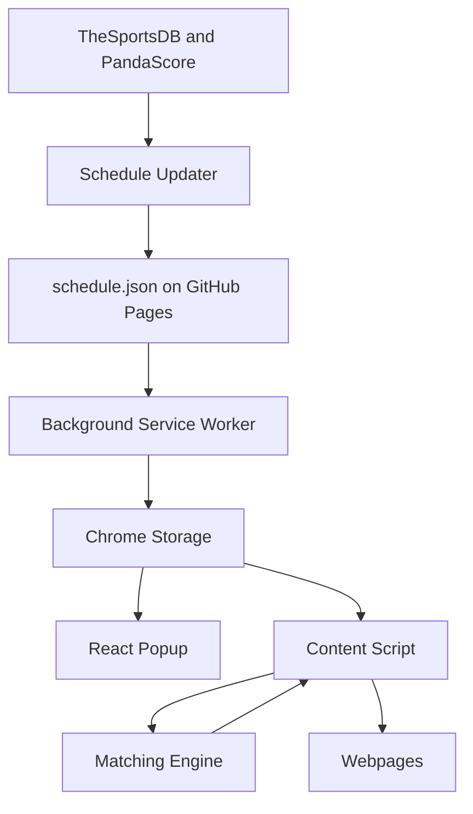

# StopSpoiling System Architecture

StopSpoiling has two main parts: a schedule updater and a Chrome extension. The updater collects sports and esports schedules, while the extension uses that data to find and hide possible spoilers on webpages.

## System Block Diagram



## Main Components

| Component | Responsibility | Technology |
|---|---|---|
| Schedule Updater | Downloads schedules, converts them into one format, and publishes `schedule.json` | Node.js, TypeScript and GitHub Actions |
| GitHub Pages | Hosts the schedule file used by the extension | GitHub Pages |
| Background Service Worker | Downloads the schedule every three hours and stores it locally | Manifest V3, TypeScript and `chrome.alarms` |
| React Popup | Displays today's games and lets users manage teams, keywords and watched games | React and TypeScript |
| Content Script | Reads webpage content, sends text to the matching engine and blurs spoilers | TypeScript, CSS and `MutationObserver` |
| Matching Engine | Compares page text with teams, aliases, scores and spoiler-related words | Pure TypeScript |
| Shared Types | Keeps the game and storage formats consistent across the project | TypeScript and Zod |

## React Popup

The popup is what the user sees when opening the extension. It displays today's games and lets the user select teams, add custom keywords, pause protection and mark games as watched.

The popup reads and updates settings in Chrome storage. It does not scan webpages or download schedules directly.

## Content Script

The content script runs on sites such as Google, YouTube, Reddit, X and ESPN. It collects text from the page and sends it to the matching engine. If the engine identifies a possible spoiler, the content script blurs that part of the page.

A `MutationObserver` checks new content that appears while the user scrolls. The content script handles webpage changes, but it does not contain the matching rules.

## Matching Engine

The matching engine compares webpage text with active games, team names, aliases, scores and result-related words. It returns whether the content should be hidden and the reason for the match.

It is written as pure TypeScript and does not directly use the DOM or Chrome APIs. This keeps it separate from the content script and makes it easier to unit test.

## Background Service Worker

The background service worker downloads `schedule.json` from GitHub Pages every three hours using `chrome.alarms`. It validates the schedule and stores it in `chrome.storage.local`.

It also responds when the user manually refreshes the schedule and shares stored information with the popup and content script.

## Schedule Flow

1. GitHub Actions runs the Node.js schedule updater.
2. The updater requests sports data from TheSportsDB and esports data from PandaScore.
3. Each provider's response is converted into the shared game format.
4. The updater validates and publishes `schedule.json` through GitHub Pages.
5. The background service worker downloads the schedule every three hours.
6. The popup displays games for the user's selected teams.
7. The content script and matching engine use the schedule to identify spoilers.

API keys stay in GitHub Actions secrets and are never included in the extension.

## Shared Game Format

Sports and esports providers return different data, so the updater converts every event into the same structure:

```ts
interface Game {
  id: string;
  provider: "thesportsdb" | "pandascore";
  sport: string;
  league: string;
  participants: {
    name: string;
    aliases: string[];
  }[];
  startTime: string;
}
```

Using `participants` instead of only `homeTeam` and `awayTeam` allows the format to work for both traditional sports and esports.

Each game has a stable ID created from the provider name and its event ID:

```text
thesportsdb:2085437
pandascore:957321
```

Aliases allow the matching engine to recognize different names for the same team, such as `Manchester United`, `Man United` and `Man Utd`.

## Chrome Storage

The extension separates settings from larger local data:

| Storage | Data |
|---|---|
| `chrome.storage.sync` | Selected teams, custom keywords and pause settings |
| `chrome.storage.local` | Cached schedule and watched game IDs |

Watched games are stored by their stable IDs:

```json
{
  "watchedGameIds": [
    "thesportsdb:2085437",
    "pandascore:957321"
  ]
}
```

The matching engine ignores watched games while continuing to protect the user from spoilers for other games.

## Suggested Folders

The exact top-level layout should match the monorepo setup in issue #13. Inside the extension and updater packages, responsibilities should remain separated like this:

```text
extension/src/
├── popup/        React popup
├── background/   Service worker
├── content/      Webpage scanning and blurring
├── matching/     Spoiler-matching rules
└── shared/       Game types, storage types and messages

updater/src/
├── providers/    TheSportsDB and PandaScore connections
├── normalize.ts  Converts provider data
└── index.ts      Runs the updater
```

This separation allows team members to work on the popup, content script, matching engine and schedule updater without editing the same files.