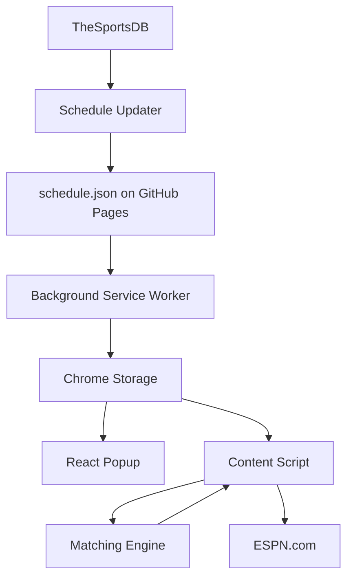

# StopSpoiling System Architecture

StopSpoiling has two main parts: a schedule updater and a Chrome extension. The updater collects game schedules, and the extension uses them to find and hide possible spoilers on webpages.

The first version (MVP) blurs **NBA** scores on **ESPN.com**. Anything beyond that is listed under Out of Scope for MVP in [Features and Requirements](./features-and-requirements.md).

## System Block Diagram



## Main Components

| Component | Responsibility | Technology |
|---|---|---|
| Schedule Updater | Downloads the NBA schedule, converts it into one format, and publishes `schedule.json` | Node.js, TypeScript and GitHub Actions |
| GitHub Pages | Hosts the schedule file used by the extension | GitHub Pages |
| Background Service Worker | Downloads the schedule every three hours, keeps the last good copy, and handles manual refresh | Manifest V3, TypeScript and `chrome.alarms` |
| React Popup | Shows the watch-list dashboard and lets users manage teams, watched games, the no-spoiler window and pausing | React and TypeScript |
| Content Script | Runs on ESPN.com, finds scores, blurs them, and handles click-to-reveal | TypeScript, CSS and `MutationObserver` |
| Matching Engine | Decides whether a piece of page text is a spoiler for a protected game | Pure TypeScript |
| Shared Types | Keeps the game and storage formats consistent across the project | TypeScript and Zod |

## React Popup

The popup is what the user sees when opening the extension. For each watch-list team, it shows the previous and next game and whether that game is blurred or watched.

From the popup, the user can:

- add or remove NBA teams from the watch-list
- mark a game as watched or unwatched
- change the no-spoiler window (48 hours by default)
- pause protection on the current site or on all sites
- refresh the schedule manually

If no schedule has ever loaded, the popup shows a **"Spoilers Ahead!"** warning instead of the dashboard.

The popup reads and updates settings in Chrome storage. It does not scan webpages or download schedules directly.

## Content Script

The content script runs only on ESPN.com pages. It starts at `document_start` and hides likely score elements with CSS before the page is drawn. This prevents a flash of an unblurred score. It then sends each element's text to the matching engine and unblurs anything that is not a spoiler.

A `MutationObserver` checks new content as it appears, so scores stay hidden during fast or infinite scrolling.

Clicking a blurred score asks for confirmation and then reveals only that score. The reveal is kept in page memory only. It is not saved, does not mark the game as watched, and the score is blurred again on reload.

ESPN-specific details, such as which elements contain scores, live in a site file (`apps/extension/src/content/sites/espn.ts`). The rest of the content script does not depend on ESPN.

## Matching Engine

The matching engine compares page text with team names, aliases and score patterns for protected games. It returns whether the content should be hidden and the reason for the match.

A game is protected when all of these are true:

1. One of its teams is on the watch-list.
2. It is not marked as watched.
3. It started less than the no-spoiler window ago (48 hours by default).
4. Protection is not paused for the current site.

It is written as pure TypeScript and does not directly use the DOM or Chrome APIs. This keeps it separate from the content script and makes it easier to unit test.

## Background Service Worker

The background service worker downloads `schedule.json` from GitHub Pages every three hours using `chrome.alarms`. It validates the schedule and stores it in `chrome.storage.local`. It also refreshes on demand when the user presses the refresh button in the popup.

If a download fails or the file is invalid, the worker keeps the last good copy, and the extension continues to work from that cache. Downloading `schedule.json` is the extension's only network request.

## Schedule Flow

1. GitHub Actions runs the Node.js schedule updater.
2. The updater requests NBA games from TheSportsDB.
3. Each game is converted into the shared game format.
4. The updater validates and publishes `schedule.json` through GitHub Pages.
5. The background service worker downloads the schedule every three hours.
6. The popup shows the previous and next game for each watch-list team.
7. The content script and matching engine use the schedule to identify spoilers.

API keys stay in GitHub Actions secrets and are never included in the extension.

## Shared Game Format

The updater converts every game into the same structure:

```ts
interface Team {
  name: string;
  aliases: string[];
}

interface Game {
  id: string;
  league: string;
  homeTeam: Team;
  awayTeam: Team;
  startTime: string;
}
```

For the MVP, `league` is always `"NBA"`.

Each game has a stable ID created from the provider name and its event ID:

```text
thesportsdb:2085437
```

Aliases allow the matching engine to recognize different names for the same team, such as `Los Angeles Lakers`, `LA Lakers` and `Lakers`.

## Chrome Storage

The extension separates settings from larger local data:

| Storage | Data |
|---|---|
| `chrome.storage.sync` | Watch-list teams, no-spoiler window, and pause settings (all sites, or a list of paused sites) |
| `chrome.storage.local` | Cached schedule and watched game IDs |

Watched games are stored by their stable IDs:

```json
{
  "watchedGameIds": ["thesportsdb:2085437"]
}
```

Pausing or stopping protection only changes the pause settings. The watch-list and watched games stay intact.

No browsing history or page content is stored.

## Project Layout

The code is a Yarn workspaces monorepo (issue #13). See `DEVELOPMENT.md` for setup.

```text
apps/extension/src/            @stopspoiling/extension
├── popup/                     React popup
├── background/                Service worker
└── content/                   Webpage scanning and blurring
    └── sites/                 Site-specific rules (espn.ts)

packages/engine/src/           @stopspoiling/engine: spoiler matching, no DOM or Chrome APIs
packages/shared/src/           @stopspoiling/shared: game types, storage types and messages

services/schedule-updater/src/ @stopspoiling/schedule-updater
├── providers/                 TheSportsDB connection
├── normalize.ts               Converts provider data
└── index.ts                   Runs the updater
```

Keeping the matching engine and shared types in their own packages means the extension and the updater use the same game format. It also lets team members work on the popup, content script, matching engine and schedule updater without editing the same files.
