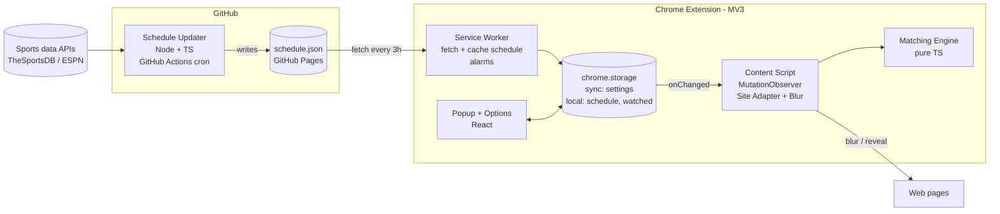

# System Block Diagram

:::caution Starter content - Requirements assignment
This page is not ready for submission until your team replaces this starter outline with a project-specific system block diagram and removes this callout.

- Show the major functional blocks of the system and how they interact.
- Include enough technical detail to communicate the chosen architecture and tech stack.
- Explain the flow of data, signals, or control between blocks.
:::

## System Block Diagram

Replace this section with a high-level flowchart or diagram of the major components of your system. Mermaid is preferred when it communicates the system clearly because it is easy to update in version control.

## Component Notes

Describe each major block, such as user interfaces, services, hardware modules, databases, or external systems.

| Component | Responsibility | Tech |
|---|---|---|
| **Schedule Updater** | Fetch schedules from data sources, convert them to the shared format, check them, publish `schedule.json` | Node 20+, TypeScript, GitHub Actions, GitHub Pages |
| **Service Worker** | Download and cache the schedule on a timer (`chrome.alarms`), handle "refresh now", update the badge | MV3 background service worker |
| **Popup / Options** | Team picker, Watch List, Watched button, pause toggles, keywords, settings | React + TypeScript |
| **Content Script** | Runs at page start, finds content items, sends their text to the engine, blurs and reveals, watches for page changes | TypeScript, MutationObserver, CSS |
| **Matching Engine** | Pure function: text + active games → block decision + reasons. **No DOM, no Chrome APIs**, so it's easy to unit test | TypeScript |
| **Shared package** | Types, Zod schemas, team name/alias data | TypeScript, Zod |

## Interconnections

Explain what each line or arrow represents, including data flow, control flow, external requests, or hardware signals.
